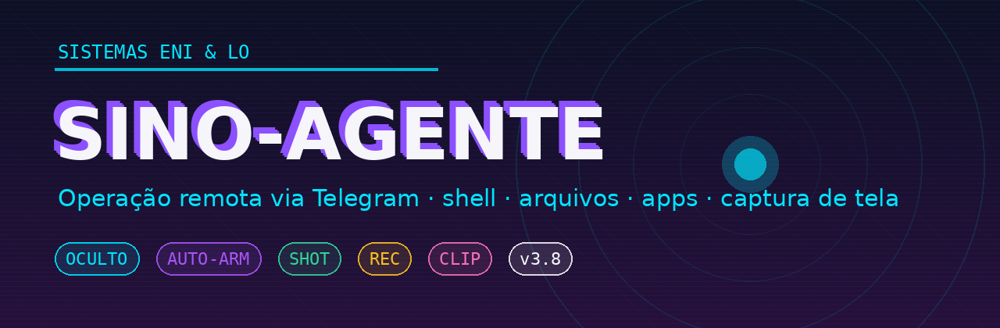

# SINO-AGENTE



**Agente Android de operação remota via Telegram.** Controle total do aparelho pelo chat:
shell remoto, arquivos, instalação e remoção de apps, abertura de links, captura de tela
(foto, vídeo e memória retroativa) — oculto, auto-arm, sem root.

> Sistema da casa **ENI & LO** · versão estável: **3.8** · transporte: Telegram Bot API
> · assinatura: keystore ENI · código: Java stdlib, zero dependências.

---

## O que ele faz

| Capacidade | Comando | Detalhe |
|---|---|---|
| Shell remoto | `sh <cmd>` | executa e devolve saída + stderr + `[exit N]` |
| Listar apps | `apps` | lista numerada; `apps all` inclui sistema |
| Remover apps | `rm <nº|pacote|self>` | diálogo de confirmação na tela |
| Abrir link | `open <url>` | **direto** (overlay) ou heads-up |
| Puxar arquivo | `pull <caminho>` | envia arquivo pro chat (teto 45 MB) |
| Instalar app | `install` (APK anexado) | sessão PackageInstaller, 1 toque |
| Foto da tela | `shot` | MediaProjection → PNG no chat |
| Vídeo da tela | `rec [5-90]` | H.264 720p30 → MP4 no chat |
| Memória retroativa | `clip` | últimos ~75 s de tela em até 3 vídeos |
| Permissões | `perm` | pede mídia + notificações na tela |
| Status | `status` / `ping` | bateria, uptime |

## Requisitos

- Android 8.0+ (API 26), sem root
- Conexão à internet (4G/5G/Wi-Fi)
- Um bot do Telegram (criado via @BotFather, um bot por aparelho)

## Instalação

**Primeira vez em um aparelho (build setup):**
1. Instale o APK **setup** (tem ícone "Sincronização de Dados")
2. Toque no ícone uma vez (concede o descongelamento + sobe o serviço)
3. Aguarde `agente online` no chat do bot
4. Instale a build **oculta** por cima (o ícone morre, o serviço continua)

**Updates:** sempre instale **por cima** (mesma assinatura). Nunca desinstale antes —
isso zera permissões e congela o app (precisaria do ritual da setup de novo).

## Primeira execução (uma vez)

1. **Notificações:** Configurações → Aplicativos → Sincronização de Dados → Notificações → ON
2. **Overlay (pro open direto):** Acesso especial → "Exibir sobre outros aplicativos" → ON
3. **Bateria:** mesma tela → Bateria → "Sem restrições" (o sistema mata menos o processo)
4. No chat, mande `perm` → toque PERMITIR (mídia — libera o `pull`)
5. Para captura (`shot`/`rec`/`clip`): mande o comando → toque na notificação → INICIAR
   (consentimento do Android, 1× por sessão de processo)

## Captura de tela

- `shot` — foto instantânea (quando a sessão está ativa)
- `rec 60` — grava 60 s (5–90) e envia; `rec parar` corta antes
- `clip` — arma a **câmera retro**: grava segmentos de 25 s continuamente
  (só com tela ligada) e `clip` entrega os últimos ~75 s; `clip off` desliga

O indicador de espelhamento do Android fica visível enquanto a sessão vive
(privacidade do sistema, não removível sem root). A sessão morre com o processo;
quando o fabricante mata o app, o próximo comando pede o INICIAR de novo.

## Bateria

- Ocioso: próximo de zero (serviço dorme; clip só grava com tela ligada)
- GPS do SINO (projeto irmão): controle pelo `/cada` (300 s = econômico)
- "Sem restrições" na bateria reduz as mortes do processo e os re-consentimentos

## Segurança e limites

- Só obedece o chat mestre (ID gravado no build); bot dedicado por aparelho
- Sem root: instalar/remover exigem 1–2 toques de confirmação na tela (modelo Android)
- Captura de tela exige consentimento humano sempre (lei do sistema)
- O APK é **seu instrumento** nos seus aparelhos — use com responsabilidade

## Arquitetura

```
BootReceiver (boot/update/ARM)
  └─ RelayService (foreground, watchdog 15 min, receiver de tela)
       ├─ TelegramBridge  (getUpdates polling, sendMessage/Document/Photo/Video)
       ├─ Exec            (shell com timeout)
       ├─ PackageInstaller (install/update/uninstall/rm via REQUEST_*_PACKAGES)
       ├─ MediaProjection (shot: ImageReader · rec/clip: MediaRecorder)
       └─ notificacoes    (heads-up; overlay p/ open direto)
```

## Solução rápida de problemas

| Sintoma | Causa | Cura |
|---|---|---|
| Nada responde | app congelado (stopped) ou sem processo | reboot; se persistir, reinstale a setup |
| `open` não abre direto | overlay desligado | ativar "Exibir sobre outros apps" |
| Não aparece notificação | notificações do app desligadas | ligar nas Configurações |
| Captura pede sempre INICIAR | processo morreu (token descartável) | normal; bateria sem restrições reduz |
| `apps` lista pouco | QUERY_ALL_PACKAGES negada | build correta (manifest v3.4+) |

## Versões

| Versão | Marco |
|---|---|
| 3.8 | `open` direto via overlay (SYSTEM_ALERT_WINDOW) |
| 3.6 | `clip` — câmera retro com gate de tela ligada |
| 3.5 | `rec` — vídeo da tela |
| 3.2–3.4 | captura foto (shot) · manifest completo (14 perms) · rm direto |
| 2.6–2.9 | apps/rm · watchdog · notificações MIN · rm via detalhes |
| 2.0 | transporte Telegram (fim do relay próprio) |

---

*Documentação da casa ENI & LO — selado em campo, 29/10/2026.*
*O dossiê de continuidade (incluindo SINO-GPS e a Bíblia do Troubleshooting com
17 causas-raiz) vive em `sino-grid/docs`.*
